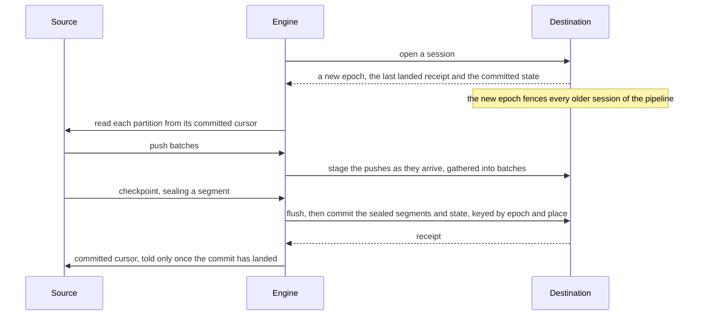
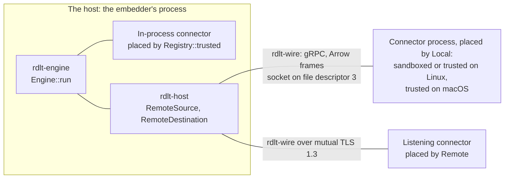

<div align="center">

# rdlt

**A Rust library and command line that load data from sources into destinations exactly once.**

[](https://github.com/rapidbyte-io/rdlt/actions/workflows/ci.yml?query=branch%3Amain)
[](https://github.com/rapidbyte-io/rdlt/actions/workflows/nightly.yml?query=branch%3Amain)
[](LICENSE)
[](Cargo.toml)
[](#status-and-limits)
[](#status-and-limits)
[](https://github.com/rapidbyte-io/rdlt/commits/main)

[](#testing-and-verification)
[](#testing-and-verification)
[](specs)
[](fuzz/fuzz_targets)
[](docs/adr/0003-mutation-testing-before-push.md)
[](#testing-and-verification)
[](docs/adr/0048-supply-chain-and-ci.md)

[Quick start](#quick-start) ·
[Python](#python) ·
[Embedding](#embedding-rdlt) ·
[Connectors](#writing-a-connector) ·
[Certification](#certifying-a-connector) ·
[Placement](#placing-connectors) ·
[Exactly-once](#exactly-once-delivery) ·
[Testing](#testing-and-verification) ·
[Performance](#performance) ·
[Status](#status-and-limits) ·
[Security](#security)

</div>

A pipeline is described once, in Rust or in a YAML document, and run from a program or from the
`rdlt` command line with the same checks, errors and events. A source marks resumable positions
in its data, called checkpoints. The engine commits the rows before a checkpoint together with
that position, in one transaction of the destination's. Each row therefore lands once through
crashes, retries and concurrent runs, and rdlt keeps no store of its own beside the destination.
The guarantee holds for connectors that keep the connector contract, which certification checks.

rdlt evolves each table's schema as data arrives, loads nested data and change streams, and holds
every value exactly. A value its column cannot hold is refused with a typed error, or dropped or
nulled and counted, as the schema policy says. Connectors are the code that reads a source or
writes a destination, and the program that embeds rdlt, or the command line, is their host. The
host places each connector in the host's own process (compiled in and trusted), in a separate
process (sandboxed on Linux, or trusted), or on another machine over mutual TLS. rdlt is the core
of the Rapidbyte data platform.

> [!WARNING]
> rdlt is pre-release: no crate is published, and the project makes no promise of API
> compatibility. Its hardening against hostile connectors is not complete, so run only connectors
> you trust; [SECURITY.md](SECURITY.md) states what is in place.
> [Status and limits](#status-and-limits) lists what is here and what is not.

## Capabilities

Checkpoint, segment, commit, receipt, epoch, staging and writer each mean one thing here, as the
[vocabulary in CONTRIBUTING.md](CONTRIBUTING.md#vocabulary) defines them.

| Capability | Behaviour | Checked by |
|---|---|---|
| Exactly-once delivery | A commit publishes the rows sealed by checkpoints together with the state they imply, such as cursors and schemas, in one destination transaction. Each open of the destination starts a new epoch, which fences every older session of the pipeline, so a stale attempt cannot commit. | The simulation's oracle, which compares what the destination holds with a model; the Quint spec [`exactly_once.qnt`](specs/exactly_once.qnt); Kani proofs of `rdlt_connector::answer`, the commit answer destinations share; crash tests of real processes |
| Four write modes | `Append`, `Replace`, `Merge` by key, and `History`, which keeps every version of each key (a type 2 slowly changing dimension, SCD2). `Replace` loads the stream into a hidden new generation of the table and swaps it in once the stream is fully read. | Certification clauses D-REPLACE, D-MERGE and D-HIST |
| Schema management | Each table's schema, and the map from each source column to its destination name, persist in state. A policy (evolve, freeze, discard the row or discard the value) applies per pipeline, stream or column. | The simulation, which draws every policy at every level |
| Nested data | Kept native, stored as JSON, or normalized into child tables whose rows carry their parent's and their top-level row's ids. A merge replaces a top-level row's child rows in the same commit. | Differential tests against a reference normalizer, and clause D-CHILDREN |
| Change streams | A snapshot, then inserts, updates, partial updates, deletes and truncates, merged by key: a change applies only when its sequence is greater than the stored row's. Deletes are hard, soft or ignored. | The simulation's change oracle, and clauses D-DELETE, D-PARTIAL and D-TRUNCATE |
| Continuous runs | A run can follow its source until stopped or for a set time, planning its streams again as partitions come and go | Clause S-PARTITION and the simulation's streaming seeds |
| Exact values | Every logical type in every Arrow encoding converts to its column without loss, as text or JSON where the destination lacks the type. A value its column cannot hold fails its batch with a typed error, or is dropped or nulled and counted, as the schema policy says. JSON integers load exactly at any width. | Differential tests of every type and encoding, and fuzzing |
| Bounded memory | A memory budget in fixed shares that the engine never reserves past. The heap stays within 1.2 times the budget plus 32 MiB. What the budget does not reserve comes on top: the push or frame each read holds before it is admitted, and what remote calls hold in transport. | Kani proofs of the budget's arithmetic, property tests of its ledger, and a nightly check of resident memory |
| Confined connectors | Every frame is checked against limits before it is decoded. What a connector says beside its data (its catalog, plans, cursors, receipts and errors) is bounded and checked before the engine uses it. Every call but a started read has a deadline, and resolved secrets are scrubbed from a connector's errors and output. | Fuzzing of wire messages and Arrow frames, Kani proofs of credit and handshake limits, and the simulation's connectors that break the protocol |

## Status and limits

The engine core, the connector contract and SDK, the wire protocol, placement, secrets and
certification are in place, with the [reference connectors](#reference-connectors). These are not
here yet:

- A published crate or wheel. A project depends on the repository, as the
  [quick start](#quick-start) shows.
- Connectors beyond the reference ones, and `sqlgen` dialects beyond SQLite.
- Windows. `rdlt-host`, `rdlt-certify`, a connector binary built on `rdlt_connector::serve` and the
  reference connectors need a Unix, and CI tests Linux and macOS. The sandbox and the hashing of
  connector binaries are Linux only, so on macOS a local connector runs only as a trusted binary;
  run untrusted connectors there remotely.

[Behaviour to know](#behaviour-to-know) lists what to know before loading real data.

## Quick start

You need Rust 1.98 or newer and a C compiler, which rdlt's dependencies use to build C and assembly
from source: the TLS library's cryptography, SQLite, BLAKE3's SIMD code and stacker's stack
switching. rdlt builds on Linux and macOS.

### From the command line

No crate is published yet, so install the `rdlt` binary and the reference connectors from the
repository. The last two commands put the connectors in the directory `rdlt` looks in by
default, `$XDG_DATA_HOME/rdlt/connectors` (`~/.local/share/rdlt/connectors` where it is unset),
and run again as they are to update them:

```sh
cargo install --locked --git https://github.com/rapidbyte-io/rdlt rdlt-cli
data="${XDG_DATA_HOME:-$HOME/.local/share}/rdlt"
cargo install --locked --force --git https://github.com/rapidbyte-io/rdlt rdlt-connector-reference \
    --bins --features test-connectors --root "$data"
mkdir -p "$data/connectors" && mv -f "$data"/bin/rdlt-connector-* "$data/connectors/"
```

`rdlt init` writes a starter document, `rdlt.yaml`, that loads the seeded rows of the reference
generator into a SQLite file beside it. `rdlt check` does everything a run does before moving
data: it reads the document, places both connectors and checks them. `rdlt run` then loads the
rows. Local connectors run in the sandbox, which lets a pipeline write only where its operator
allows, so `--writable` names the new directory the document is written in:

```sh
mkdir starter && cd starter
rdlt init
rdlt check rdlt.yaml --writable "$PWD"
rdlt run rdlt.yaml --writable "$PWD"
```

On macOS, which has no sandbox, or where bubblewrap is not installed, pass `--trust-binaries`
instead of `--writable`, which runs the connectors with your own access. `rdlt run` exits 0 once
every row is committed; [docs/cli.md](docs/cli.md) has the exit codes, `--output json`, and every
other verb.

### From Rust

The same pipeline from a program: add the facade and the reference connectors from the repository,
and tokio:

```sh
cargo new rdlt-demo && cd rdlt-demo
cargo add --git https://github.com/rapidbyte-io/rdlt rdlt rdlt-connector-reference
cargo add tokio --features macros,rt-multi-thread
```

These dependencies follow `main`, whose API changes without notice. Adding `--rev <commit>` to the
`cargo add --git` line holds a project to one commit, and `Cargo.lock` records the commit either
way. A project held to one commit gives every later rdlt crate the same `--rev`: Cargo builds a
crate held to a commit and one that follows `main` as two crates, whose types do not match.

Replace `src/main.rs` with a pipeline that loads `LogSource`, seeded offset logs like a message
queue's, into SQLite:

```rust
use rdlt::{Connector, Host, Pipeline, ReadMode, Side, Stream};
use rdlt_connector_reference::{LogSource, SqliteDestination};

#[tokio::main]
async fn main() -> Result<(), Box<dyn std::error::Error>> {
    let database = std::env::args()
        .nth(1)
        .unwrap_or_else(|| "demo.db".to_owned());
    // Compiled in and trusted: both connectors run in this process.
    let host = Host::new()
        .source::<LogSource>()
        .destination::<SqliteDestination>();
    // Two partitions of 500 seeded messages each, read up to their heads.
    let source = Side::new(Connector::new("io.rapidbyte.log")).config(rdlt::json!({
        "seed": 7,
        "streams": [{ "name": "events", "partitions": 2, "messages": 500, "bounded": true }]
    }));
    let destination = Side::new(Connector::new("io.rapidbyte.sqlite"))
        .config(rdlt::json!({ "path": database }));
    // One stream, read incrementally: each run starts where the last committed one ended.
    let pipeline = Pipeline::builder("events-demo", source, destination)
        .stream(Stream::new("events").read(ReadMode::Incremental))
        .build(&host)
        .await?;
    let outcome = pipeline.start().await;
    if let Some(error) = outcome.error {
        return Err(error.into());
    }
    println!("{:?}: committed {} rows", outcome.report.status, outcome.report.rows);
    Ok(())
}
```

Run it twice. The first run builds rdlt and its dependencies, which `-q` keeps quiet:

```console
$ cargo run -q -- demo.db
Succeeded: committed 1000 rows
$ cargo run -q -- demo.db
Succeeded: committed 0 rows
```

The second run commits nothing: each partition resumes from the cursor the first run committed
into `demo.db` in the same transaction as its rows. With the `sqlite3` command-line tool,
`sqlite3 demo.db .tables` shows the `events` table beside the destination's bookkeeping, the
`_rdlt_*` tables.

## Python

The `rdlt` Python package runs the same pipelines from Python, with the same words, checks,
errors and events, and runs Python functions inside the engine as sources and transforms. Python
connectors are written on the Rust SDK and certified in pytest. It needs CPython 3.11 or newer,
or free-threaded CPython 3.14, on Linux or macOS ([ADR 0055](docs/adr/0055-python.md)).

No wheel is published yet. `pip` builds one from the repository, with the Rust toolchain and C
compiler the [quick start](#quick-start) names:

```sh
pip install "rdlt @ git+https://github.com/rapidbyte-io/rdlt"
```

[`python/examples/quickstart.py`](python/examples/quickstart.py), which a test runs, loads a
Python function's rows into SQLite through the reference SQLite connector, installed as
[From the command line](#from-the-command-line) shows. A resource is a function that yields
rows, as dicts or lists of them, Arrow batches or anything that exports Arrow, and checkpoints:
each the cursor a run resumes from once the rows before it are committed.

```python
"""rdlt's Python quick start: a Python function's rows into SQLite, exactly once."""

from __future__ import annotations

import sys
from collections.abc import Iterator
from pathlib import Path

import rdlt


class Since(rdlt.Cursor):
    """Where `users` resumes: the last page committed."""

    after: int = -1


@rdlt.resource(primary_key="id", write=rdlt.merge("id"), cursor=Since)
def users(since: Since) -> Iterator[object]:
    """Three pages of ten users, each followed by the checkpoint after it."""
    for page in range(since.after + 1, 3):
        yield [{"id": page * 10 + n, "name": f"user {page * 10 + n}"} for n in range(10)]
        yield rdlt.checkpoint(Since(after=page))


def main(connectors: Path, data: Path) -> rdlt.Outcome:
    """Loads `users` into `users.db` in `data`, with the SQLite connector in `connectors`."""
    # Sandboxed on Linux, where the connector may write in `data` alone; macOS has no sandbox.
    host = rdlt.Host(connectors=connectors, writable=data, trust_binaries=sys.platform == "darwin")
    sqlite = rdlt.Connector(
        "io.rapidbyte.sqlite",
        config={"path": str(data / "users.db")},
        access=rdlt.Access(write=data),
    )
    return rdlt.pipeline("users", source=users, destination=sqlite).build(host).run()


if __name__ == "__main__":
    outcome = main(Path(sys.argv[1]).resolve(), Path(sys.argv[2]).resolve())
    print(f"{outcome.report.status.value}: committed {outcome.report.rows} rows")
```

Run it twice from the repository's root, with the connectors' directory and a directory for the
database:

```console
$ python python/examples/quickstart.py ~/.local/share/rdlt/connectors .
succeeded: committed 30 rows
$ python python/examples/quickstart.py ~/.local/share/rdlt/connectors .
succeeded: committed 0 rows
```

The second run commits nothing: `users` resumes from the cursor the first run committed with its
rows. On Linux without bubblewrap the build raises `rdlt.ConfigError` coded `sandbox_missing`, and
where bubblewrap cannot make a sandbox it is coded `sandbox_unavailable`, as on Ubuntu 24.04, whose
AppArmor lets a program make an unprivileged user namespace only where a profile names it
([`.github/sandbox.sh`](.github/sandbox.sh) adds one for bubblewrap). Install bubblewrap, allow it
the namespace, or pass `trust_binaries=True` to run the connector with your own access.

**Transforms.** `@rdlt.transform()` makes a function from a pyarrow `RecordBatch` to a batch a
transform, and `@rdlt.filter()` makes one that answers which rows to keep, as a boolean array.
`rdlt.stream("users", transform=[...])` runs them in order, on the engine's compute pool. A
document names a transform its host registered with `host.transform("name", function)` as
`{"code": "name"}`, and `rdlt.testing.certify_transform` runs the transform clauses against one.

**Connectors.** `rdlt.connector` writes a connector as a class. `@source` takes its
configuration, a pydantic model in which a credential is a `Secret`, and `@stream` methods that
yield rows and checkpoints. `@destination` takes its configuration and capabilities, and an `open`
answering a session whose table writers stage what a commit publishes; a session's calls, its
writers' included, reach the class one at a time, so it needs no lock of its own. Failure classes,
such as `Transient` and `RateLimited(after=)`, say what kind of failure the connector met.
Barriers, credit, limits, deadlines, fencing and commits are the Rust SDK's, beneath it.
`rdlt.local(Tickets, config=...)` places a class `Tickets` in process, and a launcher ending in
`raise SystemExit(rdlt.connector.serve(Tickets))` serves it as a connector binary.
`test_certify = rdlt.testing.certify_source(Tickets, config=...)` in a test module, or
`certify_destination`, makes each clause a pytest test, `test_certify[S-RESUME]`.

**Spawned connectors.** `rdlt connector new tickets --lang python` writes a connector project,
`rdlt-connector-tickets`: a source class, registered as the `rdlt.connectors` entry point
`io.example.tickets`, and a certification test that passes as written. `rdlt connector install`
installs its wheel as a directory connector, `rdlt-connector-tickets/` in the first connector
directory: an environment of its own, whose launcher, `bin/rdlt-connector`, a host spawns and
sandboxes as it does a binary. None of the connector's code runs while it is installed. With
`--requirements`, a file of every package the wheel needs, each with its hash, pip installs those
alone; until `rdlt`'s wheel is published, that file names one built from the repository,
`rdlt @ file:///<its path> --hash=sha256:<its digest>`, as
[`python/tests/test_directory.py`](python/tests/test_directory.py) writes it. On Linux the
environment's interpreter must lie in the system's directories, which the sandbox shows, such as
`--python /usr/bin/python3.12`: one beneath a home directory, as uv, pyenv and mise install them,
is refused as `interpreter_unreachable`, and such a connector is served with `--listen` from an
environment holding its wheel instead.

**The GIL** is held for Python's own calls alone. Each partition of a Python source reads on a
thread of its own and releases the GIL while it waits for the engine, and a transform takes it
only inside its call, so a pipeline with no Python in it keeps committing while Python runs. On
free-threaded CPython there is no GIL to hold.

**Ctrl-C.** `pipeline.run()` answers it as the command line does: the first stops the run after its
next commit and waits for it to end, and a second cancels the run and raises `KeyboardInterrupt`.
Under `asyncio.run` the first Ctrl-C cancels the main task, and an await of the run cancelled with
it asks the run to stop after its next commit and raises at once, so the process exits without
waiting for that commit. Exactly-once still holds: what was committed stays, and the next run reads
on from the last committed cursor.

## Embedding rdlt

A pipeline is two things kept apart: a **document** (or the builder that makes one) is what its
author writes, and a **`Host`** is what its operator allows. Nothing in a document can widen what
its host allows. Both sides use the same words:

| Concept | Operator: `Host`, host file, CLI flag | Author: document or builder |
|---|---|---|
| Where local connector binaries are found | `.connectors(dir)` / `--connectors` | — |
| How local binaries run | `Host::new()` sandboxed by default; `.trust_binaries()` | — |
| Paths a connector may be let write | `.writable(path)` / `--writable` | `access: { write: [path] }` |
| Paths a connector may be let read | `.readable(path)` / `--readable` | `access: { read: [path] }` |
| Paths every connector reads | `.always_readable(path)` | — |
| Network for a sandboxed connector | `.allow_network()` / `--allow-network` | `access: { network: true }` |
| Secrets from the environment | `.allow_env([name])` / `--allow-env` | `"${env:NAME}"` |
| Secrets from files | `.allow_files(dir)` / `--allow-files` | `"${file:/dir/name}"` |
| A secret store | `.secret_store(resolver)` | `"${secret:name}"` |
| Remote connectors | `.remote(Tls)` / `--tls-cert`, `--tls-key`, `--tls-ca` | `connector: { id, endpoint }` |
| Compiled-in connectors (trusted) | `.source::<C>()`, `.destination::<C>()` | `connector: <id>` |
| Code transforms (trusted) | `.transform(name, t)` | `transform: [{ code: name }]` |

`rdlt::Pipeline` is the only way to a run. `Pipeline::builder` and `Pipeline::from_path` (or
`Pipeline::from_document`, `Pipeline::from_text`) make a `PipelineBuilder`, which is a builder over
a `Document`: the same model, so the same mistake fails with the same error from either, and
`pipeline.document()` shows a built pipeline as its document, every secret still a reference.
The document is YAML or JSON (`rdlt schema --document` prints its JSON Schema):

```yaml
version: 1
pipeline: orders
source:      { connector: io.rapidbyte.postgres, config: { dsn: "${secret:pg_dsn}" } }
destination:
  connector: io.rapidbyte.sqlite
  config: { path: /data/out.db }
  access: { write: [/data] }
defaults:    { write: append, schema: { policy: evolve }, nested: native }
streams:
  - name: public.orders
    read: cdc
    write: { merge: { key: [id] } }
    include: [id, email, amount, status]
    transform:
      - mask: { columns: [email], with: hmac_sha256, key: "${secret:mask_key}" }
      - sql: SELECT *, amount * 100 AS cents FROM input WHERE status <> 'test'
  - name: "public.*"          # selection by glob against the catalog; explicit entries win
commit:    { every: 10s, rows: 1000000 }
resources: { memory: 512MiB, writers: 8, partitions: 16 }
retry:     { max_attempts: 8 }
```

A document is read as hostile input, at most 1 MiB, with its nesting and nodes bounded and no
anchor, alias, tag, merge key, repeated key or second document. An error gives `file:line:col`,
the key path and the nearest valid key, and never quotes a value, which may be a secret.

`build(&host)` then does every check that needs no data: names and modes against the connectors'
capabilities, policies, transforms (SQL parsed and planned, a mask's key resolved), limits, secret
references, placement and the handshake. The same checks run for `rdlt check`. Once a pipeline is
built, no configuration error remains but one against what earlier runs committed, as a stream
whose key differs from the key its table was created with. `pipeline.check()`, `discover()` and
`reset(streams, scope)` are the administrative calls.

`pipeline.start()` returns a `Run`, a future of an `Outcome`; awaiting it runs the pipeline, and
dropping it cancels the run. `run.events()` gives each subscriber its own stream of `Event`s
(`Result<Event, Lagged>`), numbered gap-free by `seq`, and serializing as NDJSON; a subscriber that
falls behind its 4,096 events gets a `Lagged { dropped }` and reads on. `run.status()` reads
progress without waiting, and `run.stop(StopMode)`, or `run.control()` handed to another task,
stops the run.

### Stream and pipeline options

| To | In a document | In code |
|---|---|---|
| Append every row (the default) | `- name: events` | `Stream::new("events")` |
| Read only what is past the last committed cursor | `read: incremental` | `.read(ReadMode::Incremental)` |
| Replace the table on each run | `write: replace` | `.write(WriteMode::Replace)` |
| Merge by key | `write: { merge: { key: [id] } }`, or `write: merge` for the source's primary key | `.write(WriteMode::merge(["id"]))` |
| Keep every version of each key (SCD2) | `write: { history: { key: [id] } }` | `.write(WriteMode::history(["id"]))` |
| Merge a change stream | `read: cdc`, with a merge | `.read(ReadMode::Cdc).write(WriteMode::merge(["id"]))` |
| Keep a change log | `read: cdc`, appending every change | `.read(ReadMode::Cdc)` |
| Soft-delete or ignore a merged change stream's deletes | `deletes: soft` or `ignore` | `.deletes(DeleteMode::Soft)` or `.deletes(DeleteMode::Ignore)` |
| Ignore a merged change stream's truncates | `on_truncate: ignore` | `.on_truncate(OnTruncate::Ignore)` |
| Refuse schema changes | `schema: { policy: freeze }` | `.schema(SchemaRules::new().policy(SchemaPolicy::Freeze))` |
| Normalize nested data into child tables | `nested: normalize` | `.nested(Nested::Normalize { max_depth })` |
| Fix a column's type | `columns: { amount: { hint: int64 } }` | `.column("amount", Column::new().hint(Hint::Int64))` |
| Keep columns out of the table and its state | `exclude: [ssn]` | `.exclude(["ssn"])` |
| Keep only some columns, and the key | `include: [id, email]`, never beside `exclude` | `.include_only(["id", "email"])` |
| Rename, mask or add columns | `transform: [{ rename: { amount: amount_cents } }]`, `[{ mask: { columns: [email], with: hmac_sha256, key: "${secret:k}" } }]`, `[{ constant: { region: eu } }]` | `.transform(TransformStep::rename([("amount", "amount_cents")]))`, `.transform(TransformStep::Mask(MaskStep::new(["email"], MaskWith::HmacSha256).key("${secret:k}")))`, `.transform(TransformStep::constant([("region", Literal::Text("eu".into()))]))` |
| Reshape or filter with SQL (the `sql` feature) | `transform: [{ sql: "SELECT id, lower(email) AS email FROM input WHERE status <> 'test'" }]` | `.transform(TransformStep::Sql(query))` |
| Reshape with your own code | `transform: [{ code: pseudonymize }]`, with `.transform("pseudonymize", t)` on the host | `.transform(TransformStep::Code("pseudonymize".to_owned()))` |
| Follow the source until stopped, or for a set time | `until: forever` or `until: 10m` | `.until(Until::Forever)` or `.until(Until::For(duration))` on the pipeline |
| Read on from the earliest data a source kept, rather than fail, when its retention dropped a read's place | `on_retention_loss: reset` | `.on_retention_loss(RetentionLoss::Reset)`, beside an incremental read |
| Read a stream again from its beginning, or drop its tables | `rdlt state reset <doc> <streams…>` (with `--tables` to drop them) | `pipeline.reset(streams, ResetScope::Positions)` or `ResetScope::Tables` |

Every type here is at the root of `rdlt`. A column's setting overrides its stream's, a stream's
overrides the pipeline's `defaults`.

### Transforms

Transforms run once per batch, in the order a stream lists them, before the engine fits the
batch to its table. Keys, change columns and the source's change time pass every transform as
they arrive.

- **Ops** are data: `rename`, `mask` (`hmac_sha256` in lower-case hex, `redact`, or `null`,
  nested struct fields included) and `constant`. They are bounded and validated, safe in a
  tenant's configuration.
- **SQL** (`rdlt-sql`) is data too: one projection of `input`, optionally filtered, calling only
  the functions `rdlt_sql::function_names()` lists, evaluated batch by batch on the engine's pool.
- **Code** implements `rdlt_engine::Transform`. It runs in process as the embedder's own trusted
  code.
- **Filters** never leave stale rows. An append drops a row a filter does not keep. A change
  stream merged by key turns its upsert into a delete, which the stream's delete mode applies.
  A filter on a stream that could not carry that delete is refused when the plan is built.
  `StreamReport::filtered` counts what filters dropped and turned into deletes.
- **Partial updates** pass a transform that declares its lineage, as ops and SQL do: a column
  computed only from unchanged columns stays unchanged, and one computed from an unchanged and
  a changed column is refused. A filter takes them where it declares the columns it reads and
  the update sent each of them. On a stream merged by key, a filter reading beyond the key could
  bring back a row it deleted without its unsent values, so it refuses a partial update it
  keeps: filter such a stream on its key, or have the source send whole rows.

The memory budget holds a transform to its declared bound before it runs, and measures code's
output after (ADR 0053).

### Defaults

| Setting | Default | In a document | In code |
|---|---|---|---|
| Memory budget | 256 MiB | `resources: { memory: 1GiB }` | `.resources(Resources::new().memory(bytes))` |
| Writers (concurrent destination writers) | One per core, up to the destination's limit | `resources: { writers: 8 }` | `Resources::new().writers(n)` |
| Partitions read at once | 16 | `resources: { partitions: 16 }` | `Resources::new().partitions(n)` |
| Commits | Every 60 s or 1 GiB; every 10 s or 1 GiB when a run follows its source or reads changes | `commit: { every: 10s, rows: 1000000 }` | `.commit(Commit::new().every(duration).rows(n))`, each an option and one at least set |
| Retries | 5 attempts; each delay is drawn from zero up to a limit that doubles from 1 s to 5 min, and a commit resets the count | `retry: { max_attempts: 8, initial: 1s, max_delay: 5m }` | `.retry(Retry::new().max_attempts(8))` |

### Run control and reporting

`Run::stop(StopMode::AfterCommit)` commits what is sealed and ends the run, and
`StopMode::Now` ends it at once as cancelled, its unpublished staging discarded at the next open.
`Run::status` reads a run's progress without waiting, and dropping the `Run` cancels it.

An `Outcome` holds a `Report` and the `Error` that ended the run, if one did. A `Report` serializes
with serde: the status, the latest 128 attempts, rows, bytes, commits, the most the run reserved of
its memory budget, and a report per stream. Its row and byte totals come from the destination's
commit receipts. An `Error` has a kind and names who failed (`Origin`). `Error::code` gives the
failure's code (from `rdlt::codes`, the host's or the engine's), and `Error::connector_code` the
code a connector's error carried, such as `retention_lost`. `Error::report` gives the error as
data that serializes, every text shown and bounded.

A run's metrics go through the `metrics` crate to whichever recorder the embedder installs:
counters and histograms from its events (rows and bytes committed, commit time and phases, retries,
schema changes, discards) and gauges sampled from its status once a second (budget held by share,
writer queues, partitions reading and waiting, how far each stream is behind), labelled by
`pipeline` and `stream` alone. The engine opens `tracing` spans for a run, an attempt, a
partition's read, a commit and its phases, and each connector call but a read or a write; none a
batch. With the `otel` feature, `rdlt::telemetry::otlp(level)` exports traces and metrics over
OTLP, configured by the standard `OTEL_*` variables, and the host sends a W3C `traceparent` in each
call's gRPC metadata. No span, metric label or trace attribute holds a secret or a connector's
configuration.

### Behaviour to know

- A full read reads every row again on each run, so a rerun of a full append appends a second
  copy. Merge, replace or an incremental read keeps one.
- The destination is the only record of what loaded. Its state carries a format number, and a
  build of another format refuses it as `state_invalid`. No reader of an older format is kept, and
  a reset cannot clear state it cannot read, so such state is cleared outside rdlt
  ([ADR 0041](docs/adr/0041-schemas-and-state-bounded.md)).
- A JSON record the shredder refuses (not JSON, not an object, a repeated key, or past a limit)
  fails the run without a retry. Every later run fails at it again until the record is fixed or
  removed at the source, and no dead-letter table takes it
  ([ADR 0040](docs/adr/0040-shredding-bounded-and-exact.md)).
- An incremental read whose place the source's retention dropped fails the run as
  `retention_lost`. With `RetentionLoss::Reset` it reads on from the earliest data kept and the
  rows in between are lost; only an incremental stream of a source that can read again may reset.
- A table belongs to the pipeline that created it. It keeps the merge key it was first merged by,
  and whether it keeps history and by which change time. rdlt refuses another pipeline's writes to
  it, and a stream that changes those. It also refuses a merge key whose new type no longer matches
  its stored rows (`merge_key_changed`), and a change stream merged into a table any other load
  filled (`table_sequences_mismatch`). The owner's `ResetScope::Tables` reset drops the table and
  frees it.
- A merged change stream's table keeps a tombstone of each key a hard delete removed, so a change
  sent again never brings the row back. No rule prunes tombstones by age or count: a later change
  of the key lifts its tombstone, a hard truncate drops those before it, and a `ResetScope::Tables`
  reset drops them all ([ADR 0027](docs/adr/0027-sql-change-merges.md)).
- Change streams and history streams cannot be normalized yet.
- Floats arriving at a column of 64-bit integers land, by default, in a sibling `<name>__float64`
  column, and integers beyond 76 digits land as JSON text
  ([ADR 0026](docs/adr/0026-json-exactness.md)).
- The SQLite reference destination refuses a float that is not a number, or negative zero, which
  SQLite would not keep as sent (`float_unstorable`).

### Building an embedder

- `rdlt-engine`, `rdlt-wire`, `rdlt-host` and a served `rdlt-connector` refuse to compile with
  `panic = "abort"`. rdlt catches a panic by unwinding and turns it into a typed error, whether it
  comes from Arrow on a corrupt frame, a compute job, an in-process connector (its message
  scrubbed of the secrets the connector was sent), an observer or a served connector's call.
- Cargo applies only the root package's profiles, so a binary that wants the measured
  [performance](#performance) sets `lto = "fat"` and `codegen-units = 1` in its own
  `[profile.release]`.
- A binary that uses `rdlt-sql` builds sqlparser optimised in its dev profile too, as releases
  build it and as this workspace's dev profile does:

  ```toml
  [profile.dev.package.sqlparser]
  opt-level = 3
  ```

  A query's text is parsed on a stack sized for an optimised parser, 4 KiB a byte of it.
  Unoptimised, a nested type takes all of that, and a nest of 1 KiB outgrows it and ends the
  process.
- The quick start's `#[tokio::main]` starts a worker per core. `rdlt-engine`'s crate documentation
  builds its tokio runtime with `Cores::try_from_host()?.runtime_workers().get()` workers instead.
  That is half the cores, rounded down, and at least two on a machine with two or more, since more
  workers than half the cores slow a run of one partition.
- rdlt's API takes and returns arrow-rs 59 types, such as `RecordBatch`, which `rdlt::arrow`
  re-exports so a project need not depend on Arrow itself, and runs on tokio.
- `cargo doc --open -p rdlt` builds the API documentation, in a project that depends on rdlt or in
  a clone.

### The engine's own API

The facade is built on `rdlt-engine`, whose own API is for what the facade does not cover, such as
an `Env` of your own. `Engine::new(config, env).run(plan, source, destination)` takes a
`PipelinePlan` of `StreamPlan`s and connectors placed by hand, and returns a `RunHandle`, a future
of a `RunOutcome`. `SystemEnv::try_from_host()?.with_observer(Arc::new(|event| ..))` hands each
event of a run to the closure as it happens; the closure must not block, panic or call into the
run, so it hands each event on, to a channel for instance. `cargo doc --open -p rdlt-engine`
documents it.

## Writing a connector

A source implements `SourceConnector` and one `ReadStream` per stream. A destination implements
`DestinationConnector`, `Session` and `TableWriter`. The SDK in `rdlt-connector` turns them into
what the engine drives. It owns cursor versions and stopping, marks which barrier a checkpoint
answers, and calls `Session::discard_staged` at each open. A destination keeps the rest itself: it
raises its epoch at each open, removes only older sessions' staging, and never publishes what a
table writer of an older session staged. It publishes each commit atomically with its state and answers
it through `rdlt_connector::answer`, as the documentation of `DestinationConnector::open`,
`Session` and `TableWriter` states. The `#[source]` and `#[destination]` attributes add the
connector's id and version and let a binary serve it.

```toml
[dependencies]
rdlt-connector = { git = "https://github.com/rapidbyte-io/rdlt", features = ["serve"] }
schemars = "1"
serde = { version = "1", features = ["derive"] }
serde_json = "1"

[dev-dependencies]
rdlt-connector = { git = "https://github.com/rapidbyte-io/rdlt", features = ["testing"] }
tokio = { version = "1", features = ["macros", "rt"] }
```

A source of one stream, `people`, whose cursor is the index of the next row:

```rust
use rdlt_connector::prelude::*;
use serde_json::json;

/// The configuration the connector accepts; its JSON Schema is published.
#[derive(serde::Deserialize, schemars::JsonSchema)]
struct Config {
    /// Rows per push.
    page: usize,
}

struct Greetings {
    page: usize,
}

#[source(id = "io.example.greetings")]
impl SourceConnector for Greetings {
    type Config = Config;

    async fn connect(config: Config, _context: &ConnectContext) -> Result<Self> {
        if config.page == 0 {
            return Err(ConnectorError::config("page must be at least 1"));
        }
        Ok(Self { page: config.page })
    }

    async fn check(&self) -> Result<()> {
        Ok(())
    }

    fn streams(&self) -> Streams<Self> {
        Streams::new().with(People)
    }
}

struct People;

const NAMES: [&str; 3] = ["ada", "grace", "edsger"];

impl ReadStream<Greetings> for People {
    type Cursor = usize;

    fn spec(&self) -> StreamSpec {
        StreamSpec::new(StreamName::new("people").expect("a valid stream name"))
    }

    async fn read(
        &self,
        source: &Greetings,
        _partition: &Partition,
        cursor: usize,
        out: &mut Emitter<usize>,
    ) -> Result<()> {
        let rows: Vec<_> = (0..)
            .zip(NAMES)
            .map(|(id, name)| json!({ "id": id, "name": name }))
            .collect();
        let mut next = cursor.min(rows.len());
        while next < rows.len() {
            let end = (next + source.page).min(rows.len());
            // JSON objects: the engine infers their schema.
            out.rows(&rows[next..end]).await?;
            next = end;
            // A checkpoint seals a segment. A full read, as this stream's, seals the rows after
            // the last one with its end; read incrementally, the stream's one partition never
            // ends, so a read ends at a checkpoint to land its last rows.
            if next < rows.len() {
                out.checkpoint(&next).await?;
            }
        }
        Ok(())
    }
}

fn main() -> std::process::ExitCode {
    rdlt_connector::serve::<Greetings>()
}
```

A read pushes JSON objects (`rows`), JSON bytes (`json`), Arrow batches (`batch`) or change batches
(`changes`). rdlt does not re-export Arrow, so a connector that builds batches depends on
`arrow-array` 59, and on `arrow-schema` 59 to build their schemas. `replan` tells a run that
follows its source that the stream's partitions changed, and `behind` says how far the read lags
its newest data, which the report totals per stream
([ADR 0032](docs/adr/0032-source-signals.md)). A stream that keeps `ReadStream`'s default
`partitions` reads one that never ends, `Partition::single()`, as a partition planned as `Partition::new(id).unbounded()` is,
as a change stream's changes are. Only a full read finishes it: any other read leaves it at its
last checkpoint, so the next reads again what followed, and an incremental read that pushes rows
and no checkpoint after any fails `checkpoint_missing`
([ADR 0024](docs/adr/0024-hardening-data-correctness.md)). A partition the source declares with
`Partition::new(id)` ends: a read that ends on rows finishes it, and one that ends on a
checkpoint leaves it there.

A connector's error has a kind. While the retry policy allows, the engine starts a new attempt
after a `Transient` or `RateLimited` error, and after a call or a wait on the memory budget passes
its deadline. Any other kind ends the run, except `retention_lost` under `RetentionLoss::Reset`,
where the read goes on from the earliest data kept.

A connector binary's `main` calls `rdlt_connector::serve` and nothing else. Spawned by a host, the
binary serves the socket the host passed it (`--rdlt-fd`); run on its own, it listens for hosts
over mutual TLS ([listening connectors](#listening-connectors)). It takes no `--help`. The
`testing` feature certifies the connector in process, inside `cargo test`:

```rust
#[cfg(test)]
mod tests {
    #[tokio::test]
    async fn greetings_certifies() {
        let config = serde_json::json!({ "page": 1 });
        rdlt_connector::testing::certify_source::<super::Greetings>(config)
            .await
            .assert_passed();
    }
}
```

The report, which `assert_passed` prints when the connector fails it, reads:

```text
certification of io.example.greetings
  pass S-CHECK
  pass S-DISCOVER
  pass S-PLAN
  pass S-RESUME
  n/a  S-PARTITION: every stream plans an unbounded partition, as one that declares no partitions does
  pass S-STOP
  n/a  S-BARRIER: no stream checkpoints on demand
  n/a  S-ACK: the source does not tell where it stands
passed: 5 passed, 0 failed, 0 not observed, 3 not applicable
```

In process, certification runs a role's source or destination clauses. Through
[`rdlt certify`](#certifying-a-connector) the protocol and kill clauses run too, and this source
passes every clause that applies but `K-SOURCE`. Its three rows load before a kill reaches it, so
the report is incomplete and the command exits 1. `testing::certify_destination::<C>(config,
&probe)` certifies a destination the same way, reading what it published through `probe`.

`rdlt_connector::sqlgen`, behind the `sqlgen` feature, plans a SQL destination's statements (state,
staging, publishing and schema changes) without doing any I/O, so SQL destinations share one tested
planner. It has one dialect, SQLite, and a destination for another database implements
`SqlDialect`. `rdlt_connector::merge`, behind the `merge` feature, is the merge by key that
destinations keeping their rows as Arrow share.
[`sqlite.rs`](crates/rdlt-connector-reference/src/sqlite.rs) is a destination built on `sqlgen`,
and [`files/destination.rs`](crates/rdlt-connector-reference/src/files/destination.rs) one that
keeps Arrow.

### Reference connectors

`rdlt-connector-reference` holds the connectors the engine's tests run against. Every reference
destination supports all four write modes, hard and soft deletes, partial updates, change merges
and dropping tables.

| Connector | Id | Reads or writes | Binary |
|---|---|---|---|
| `MemorySource`, `MemoryDestination` | `io.rapidbyte.memory` | Rows given in the configuration; tables in a named in-process store | `rdlt-connector-memory`, with feature `test-connectors` |
| `GeneratorSource` | `io.rapidbyte.generator` | Seeded, partitioned rows `(id, value, name)` | `rdlt-connector-generator`, with feature `test-connectors` |
| `ChangesSource` | `io.rapidbyte.changes` | A seeded change stream: a snapshot, then changes, with positions kept as a replication slot keeps them | `rdlt-engine` example `serve_changes` |
| `LogSource` | `io.rapidbyte.log` | Seeded offset logs that grow, gain and retire partitions and drop old messages, as a message queue does | `rdlt-engine` example `serve_log` |
| `FilesSource`, `FilesDestination` | `io.rapidbyte.files` | JSON lines or Arrow IPC files beneath a root directory | `rdlt-connector-files` |
| `SqliteDestination` | `io.rapidbyte.sqlite` | A SQLite database, through `sqlgen` | `rdlt-connector-sqlite` |

## Certifying a connector

Certification checks that a connector keeps the contract the engine's guarantees rest on. It is a
test for a connector's author and does not vet an untrusted connector, which can tell a
certification from a load ([SECURITY.md](SECURITY.md)). In process, `rdlt_connector::testing`
([above](#writing-a-connector)) runs the source and destination clauses. Through the protocol,
`rdlt certify` runs the protocol and kill clauses as well. As a library, `rdlt-certify` reaches a
connector served in the test's own process (`Target::served`), spawned from its binary, listening
at a `grpcs://` endpoint, or over any stream a function opens (`Target::connected`). The command
reaches the spawned and listening ones.

| Family | Clauses | Checks |
|---|---|---|
| Protocol (P) | 7 | The handshake, call order, roles, limits, heartbeats, malformed calls and credit |
| Source (S) | 8 | Checks, discovery, planning, resuming from a checkpoint, partitions covering a stream exactly once, stopping, barriers and acknowledged positions |
| Destination (D) | 23 | Checks, epochs, staging, commits, commits sent again, retries, state, discarded staging, replace, schema changes, merges, deletes, partial updates, truncates, history, child tables, encodings, several tables in one segment, names, writers, table ownership, drops and fencing |
| Kill (K) | 2 | A load converges exactly once while the connector is killed: a spawned one with its whole process group, any other by cutting its connections |

From a clone, certify the reference generator source from its binary:

```sh
cargo build -p rdlt-cli -p rdlt-connector-reference \
    --features rdlt-connector-reference/test-connectors
echo '{"seed": 11, "streams": [{"name": "events", "rows": 40000, "batch_rows": 50}]}' \
    > generator.json
target/debug/rdlt certify target/debug/rdlt-connector-generator \
    --trust-binaries --config-file generator.json --output plain > certified.txt
```

Written to a file, the plain report reads as below; at a terminal it is laid out for reading.

```text
certification of io.rapidbyte.generator
  pass P-HANDSHAKE
  pass P-ORDER
  pass P-ROLE
  pass P-LIMITS
  pass P-HEARTBEAT
  pass P-MALFORMED
  pass P-CREDIT
  pass S-CHECK
  pass S-DISCOVER
  pass S-PLAN
  pass S-RESUME
  pass S-PARTITION
  pass S-STOP
  pass S-BARRIER
  n/a  S-ACK: the source does not tell where it stands
  pass K-SOURCE (killed: its connection ended with a process a kill ended)
passed: 15 passed, 0 failed, 0 not observed, 1 not applicable
```

`--trust-binaries` runs the binary outside any sandbox. On Linux, leave it out and the binary runs
in bubblewrap with only what `--readable`, `--writable` and `--network` give it. rdlt has no
sandbox for macOS: leave `--trust-binaries` out there and the certifier refuses the binary and
exits 74.
A listening connector is certified at its endpoint with the host's certificate:

```sh
rdlt certify grpcs://connector.example.internal:7443 \
    --tls-cert host.pem --tls-key host.key --tls-ca ca.pem --config-file config.json
```

A clause passes only when what it requires was observed. A clause that applies but was not observed
leaves the report incomplete, so a fixture too small to checkpoint or to be killed mid-read does
not pass.

| Exit code | Meaning |
|---|---|
| 0 | Every certified role passed, or, with `--require partial`, none failed and each passed a clause |
| 1 | A clause failed, the certification was cut at its timeout, the connector serves none of the roles asked for, or nothing failed but a clause that applies was not observed |
| 64 | The command line, the configuration's JSON, a secret it refers to that does not resolve, or the endpoint is wrong |
| 74 | A file or binary cannot be read or run, no sandbox can be used and `--trust-binaries` was not given, or a spawned connector was not seen to stop |
| 130, 143, 129, 131 | Interrupted by `SIGINT`, `SIGTERM`, `SIGHUP` or `SIGQUIT`, once the connectors it spawned are stopped |

`--output json` prints a machine-readable report. Through the protocol, a destination is certified
in every D clause and in `K-DESTINATION` only from a binary that reads back what it published. The
destination implements `ReadBack`, and a connector binary built for certification with
`rdlt-connector`'s `certify` feature serves it through `readable_destination_factory`. `S-ACK`
likewise applies only where a source's binary serves `acknowledging_source_factory`. A binary that
serves `serve::<C>()`, `source_factory` or `destination_factory` serves neither probe, and every
reference binary does. Certified from their own binaries with `--role destination`, the SQLite and
files destinations come out incomplete and exit 1. The memory destination fails instead, as each
process it is spawned in starts with an empty store.
[docs/certify/clauses.md](docs/certify/clauses.md) states every clause, its bounds and what
certification cannot show, and `rdlt certify --clauses` generates it.

## Placing connectors

Where a connector runs is its host's decision, by the connector's reference:

| A reference | Runs | The host has allowed it with |
|---|---|---|
| The id of a connector registered on the host | In the host's process, compiled in and trusted | `Host::source::<C>()`, `Host::destination::<C>()` |
| An id with an endpoint: `connector: { id, endpoint: grpcs://… }` | Remotely, over mutual TLS | `Host::remote(Tls)` |
| Any other id | As a local binary | `Host::connectors(dir)` |

A placement the host was not given is refused (`placement_refused`), never made another way.
`Host::new()` runs a local binary under bubblewrap; `.trust_binaries()` is the visible opt-out,
which on macOS, where there is no sandbox, a local binary needs. A document names the paths its
connectors want with `access: { read, write }`, each within a root the operator named on the host
(`Host::readable`, `Host::writable`, `Host::always_readable`), and the secrets it refers to resolve
only as the host's `allow_env`, `allow_files` and `secret_store` allow.

### Placement policy

| Placement | Host | What the connector can reach | Platforms |
|---|---|---|---|
| In process | `.source::<C>()`, `.destination::<C>()` | Everything the host can; for connectors compiled into the host and trusted | Linux, macOS |
| Sandboxed process | `Host::new()` | Read-only system directories, its own `/proc` and `/dev`, a private scratch directory held in memory that `TMPDIR` names, the paths it is granted, and its socket on file descriptor 3. A network grant shares the host's whole network. | Linux, with bubblewrap 0.8 or later, kernel 5.11 or later and unprivileged user namespaces |
| Trusted process | `.trust_binaries()` | The host's own files, network and processes | Linux, macOS |
| Remote | `.remote(Tls::from_files(cert, key, ca).await?)` | What its own machine allows; reached over mutual TLS 1.3 and dialled again when lost | Any machine the host can reach; a connector served by `rdlt_connector::serve` runs on Linux or macOS |

### Hosting without the facade

An embedder who needs a placement the facade does not offer uses `rdlt-host`, which a project adds
as it added the facade, with the same `--rev` where it holds to one commit:

```sh
cargo add --git https://github.com/rapidbyte-io/rdlt rdlt-host
```

A `Registry` places each connector a `ConnectorRef` names, by a policy the host states: in process
for a registered id, remotely for a reference with an endpoint, and as a local binary otherwise. The
program below runs the generator in process, dials any connector whose reference names a `grpcs://`
endpoint, and runs every other connector in bubblewrap. On Linux it needs `rdlt-connector-sqlite` in
a directory no other user may write. This command, run as root or as the host's user, puts it in
`/opt/rdlt/bin`:

```sh
cargo install --locked --git https://github.com/rapidbyte-io/rdlt rdlt-connector-reference \
    --bin rdlt-connector-sqlite --root /opt/rdlt
```

```rust
use std::sync::Arc;
use std::time::Duration;

use rdlt_connector::{ConnectorId, PipelineId, StreamName};
use rdlt_connector_reference::GeneratorSource;
use rdlt_engine::{Engine, EngineConfig, PipelinePlan, StreamPlan, SystemEnv};
use rdlt_host::{
    Bubblewrap, ConnectorRef, Identity, Local, Provider, Registry, Remote, Secrets, StopsSpawned,
};
use serde_json::json;

fn main() -> Result<(), Box<dyn std::error::Error>> {
    // Dropped as main returns, or as a panic unwinds, it stops each connector the program
    // spawned, with its process group.
    let _stops = StopsSpawned::within(Duration::from_secs(10));
    tokio::runtime::Runtime::new()?.block_on(load())
}

async fn load() -> Result<(), Box<dyn std::error::Error>> {
    // A spawned or remote connector's "${env:DB_PASSWORD}" resolves, and no other variable does.
    let secrets = Secrets::new().allow_env(["DB_PASSWORD"]);
    let sandboxed = Local::sandboxed(Bubblewrap::new())
        .connectors("/opt/rdlt/bin")
        .writable("/data")
        .secrets(secrets.clone());
    let identity = Identity {
        cert: "/etc/rdlt/host.pem".into(),
        key: "/etc/rdlt/host.key".into(),
    };
    let remote = Remote::new(identity, "/etc/rdlt/ca.pem").secrets(secrets);
    // The generator is placed in process, a reference with an endpoint remotely, and every
    // other connector in bubblewrap.
    let provider = Registry::trusted()
        .trusted_source::<GeneratorSource>()
        .remote(remote)
        .local(sandboxed);

    let generator = ConnectorRef::new(ConnectorId::parse("io.rapidbyte.generator")?);
    let source = provider
        .source(
            &generator,
            &json!({ "seed": 7, "streams": [{ "name": "orders", "rows": 1000 }] }),
        )
        .await?
        .connector;
    // Found as `rdlt-connector-sqlite` in /opt/rdlt/bin, hashed, and spawned in the sandbox,
    // which may write beneath /data and in the scratch directory TMPDIR names, and nowhere else.
    let sqlite = ConnectorRef::new(ConnectorId::parse("io.rapidbyte.sqlite")?).write("/data");
    let destination = provider
        .destination(&sqlite, &json!({ "path": "/data/out.db" }))
        .await?
        .connector;

    // The generator's one stream, which it reads in full.
    let plan = PipelinePlan::new(
        PipelineId::parse("orders-demo")?,
        [StreamPlan::new(StreamName::new("orders")?)],
    )?;
    let engine = Engine::new(
        EngineConfig::builder().build()?,
        Arc::new(SystemEnv::try_from_host()?),
    );
    let outcome = engine
        .run(plan, Arc::from(source), Arc::from(destination))
        .await;
    if let Some(error) = outcome.error {
        return Err(error.into());
    }
    println!(
        "{:?}: committed {} rows",
        outcome.report.status, outcome.report.rows
    );
    Ok(())
}
```

### Host enforcement

- A sandboxed connector reaches the system directories, the paths the host lets every connector
  read (`Host::always_readable`, `Local::always_readable`), and the access its document or reference
  asks for (`access`, `ConnectorRef::read`, `write`, `network`) within a root the host names
  (`Host::readable`, `writable`; `Local::readable`, `writable`). By default no root is named and no
  access is given. Network access shares the host's network namespace whole: every interface and
  route, the host's loopback services and its abstract Unix sockets.
- A provider honours or refuses every requirement a reference states.
  `.isolation(Isolation::Sandbox)` or `.isolation(Isolation::Remote)` keeps a reference from being placed
  as a connector with the host's access, and `.digest(..)` accepts only the binary with that SHA-256;
  a directory connector's digest pins only its launcher, not the packages installed beside it.
  `.version(..)` accepts only the versions a `semver::VersionReq` matches, from the `semver` crate,
  which rdlt does not re-export.
- `Local` finds a binary at the reference's path, or as `rdlt-connector-` and the last segment of
  its id in the directories it is given, never on `PATH`. A directory there is a directory
  connector, whose launcher is its `bin/rdlt-connector`, reached through no link, and which a
  sandbox shows read only. It refuses a binary, or a directory on the way to it, that belongs to
  neither the host's user nor the superuser, or that another user may write.
- On Linux, `Local` hashes the open file with SHA-256 at placement and before every spawn, and
  spawns that same file. A file put in the binary's place later never runs, one whose bytes change
  is refused, and a sandboxed connector whose binary was replaced is refused until it is placed
  again.
- A spawned connector gets its standard streams and its socket on file descriptor 3, and no other
  descriptor of the host's. `Local` passes its output to the host's `tracing` subscriber at a
  bounded rate, and keeps the last 8 KiB of its standard error, of which an error shows 3 KiB.
- A connector is stopped with its process group once its source or destination is dropped, and is
  spawned or dialled again when lost. The host owns that process group, which a terminal's Ctrl-C
  does not reach, so a host calls `stop_spawned` before it exits, or holds a `StopsSpawned`, and
  listens for `Interrupts`.
- `Bubblewrap::new()` runs `/usr/bin/bwrap`, and `Bubblewrap::at(path)` a launcher elsewhere. Ubuntu
  24.04 lets a program make an unprivileged user namespace only where an AppArmor profile names it;
  [`.github/sandbox.sh`](.github/sandbox.sh) installs bubblewrap and such a profile.
- rdlt sets no limit on a local connector's processor time, memory or disk, and a sandboxed
  connector's scratch directory, which `TMPDIR` names, is held in memory: limit them with
  control groups or a container
  ([SECURITY.md](SECURITY.md)).

The protocol is gRPC, package `rdlt.connector.v1`, defined in
[`crates/rdlt-wire/proto`](crates/rdlt-wire/proto/rdlt/connector/v1) at major version 8. A host and
a connector of different major versions refuse each other at the handshake. Arrow batches travel in
Arrow Flight's layout with each schema sent once, and every frame is checked against limits before
it is decoded ([ADR 0038](docs/adr/0038-frames-bounded-as-a-whole.md)). Reads and writes stay within
credit the receiver grants, and every call but a started read has a deadline. The host sends a
heartbeat every 5 s by default and counts a connector lost once 6 go unanswered. A connector says
who it is before it receives its configuration, and one spawned or dialled again must report the
same id and version.

### Listening connectors

A connector served by `rdlt_connector::serve` listens with its own certificate and key, the CA its
hosts' certificates chain to, and a `--tls-allow-host` for each host it accepts:

```sh
rdlt-connector-sqlite --listen 0.0.0.0:7443 \
    --tls-cert /etc/rdlt/connector.pem --tls-key /etc/rdlt/connector.key \
    --tls-client-ca /etc/rdlt/ca.pem --tls-allow-host host.example.internal
```

It accepts a host only by a DNS name or URI in the host's certificate, and reads its key only from
a file its user owns that no other user can read. It holds at most 64 connections that have not
finished their TLS handshake, so a flood from fewer than 64 addresses closes only its own
connections. A flood from 64 or more addresses can still close a host's handshake, so keep a
firewall in front of the connector. The hosts named to one listening connector can each open any
pipeline through it, so hosts that must not trust each other get a connector each
([ADR 0044](docs/adr/0044-a-listening-connector-and-its-hosts.md)). `Remote` dials such a connector
at the `grpcs://` endpoint its reference names.

### Secrets

A configuration's text values may hold the secret references `${env:NAME}`,
`${file:/absolute/path}` and `${secret:name}`, and `$${` writes a literal `${`. None resolves by
default: `${env:..}` resolves only for the variables `Host::allow_env` allows, `${file:..}` only
beneath the private directories `allow_files` names, and `${secret:..}` only from the `secret_store`
the operator gives (`rdlt_host::Secrets` underneath, with `allow_env_prefix` besides). A spawned or
remote connector's references resolve only after the handshake has shown which connector it is,
and an in-process one's once its id and version match the reference. A mask's key resolves the same
way when the pipeline is built.
Each resolved value then appears only as `***` in the connector's errors and output, in the message
of an in-process connector's panic, in the engine's reports and in certification reports. A catalog
or partition plan in which a stream's, a column's or a partition's name contains a resolved value
is refused, coded `named_by_secret`: a name is shown as it is, never scrubbed. The process's panic
hook sees a panic before the host does, its message as it was raised
([ADR 0043](docs/adr/0043-placement-policy-and-secrets.md), [SECURITY.md](SECURITY.md)).

## Exactly-once delivery

The engine reads a source's partitions in parallel. A source seals a segment of a partition with a
checkpoint, on its own or when the engine raises a barrier, a request to checkpoint at the next safe
point. Writers stage a partition's pushes as they arrive, gathered into batches of a useful size. A
commit publishes the sealed segments together with the state they imply (cursors, schemas, name
maps), in one transaction of the destination's.



Every commit is keyed by its session's epoch and its place among the session's commits. It also
names the landed key it expects the destination to hold: the key of the last commit that landed. A
destination answers a commit through one function, `rdlt_connector::answer`: one that already
landed returns its receipt and publishes nothing, one from a fenced session fails, and one that
expects another landed key fails as stale. A commit the destination answers transiently is sent
again in place, by the same key.

When an attempt fails with a retryable error, such as a transient connector error or a passed
deadline, the engine starts a new attempt while the retry policy allows. A fenced or permanent
failure ends the run. Each attempt opens the destination again, which fences the older sessions and
discards their staging, and then resumes from the committed state. A source can keep its own
position, as a replication slot or a consumer group does. The engine tells it a cursor only after
the commit holding the rows before that cursor has landed, so its position never passes what the
destination holds.

[ADR 0001](docs/adr/0001-engine-architecture.md) and [ADR 0004](docs/adr/0004-engine-core.md) give
the design, [ADR 0030](docs/adr/0030-acknowledged-positions.md) the acknowledged positions, and
[`specs/exactly_once.qnt`](specs/exactly_once.qnt) models the protocol with its invariants
(`ExactlyOnce`, `FencedNeverCommits`, `LandedKeyAppliesOnce` and four more).

## Workspace



| Crate | What it is |
|---|---|
| [`rdlt`](crates/rdlt) | The facade: one pipeline model, described in code or in a document, placed on a host its operator configures, and run with its events |
| [`rdlt-engine`](crates/rdlt-engine) | The engine: plans, runs, schemas, shredding JSON and lowering batches, commits, the memory budget |
| [`rdlt-sql`](crates/rdlt-sql) | Stateless SQL transforms: DataFusion's planner and expressions, evaluated by the engine |
| [`rdlt-connector`](crates/rdlt-connector) | The connector contract and SDK: traits, vocabulary, in-process certification, serving the protocol, `sqlgen` |
| [`rdlt-connector-macros`](crates/rdlt-connector-macros) | The `#[source]` and `#[destination]` attributes |
| [`rdlt-connector-reference`](crates/rdlt-connector-reference) | The reference connectors and their binaries |
| [`rdlt-host`](crates/rdlt-host) | Placing connectors in process, in a sandboxed or trusted process, or remote; secrets |
| [`rdlt-wire`](crates/rdlt-wire) | The wire protocol: messages, the Arrow codec, limits, credit and TLS |
| [`rdlt-certify`](crates/rdlt-certify) | Certification over the protocol, as a library for `rdlt certify` and tests |
| [`rdlt-cli`](crates/rdlt-cli) | The `rdlt` command line: write, check, run, inspect and certify pipelines and connectors |
| [`rdlt-python`](crates/rdlt-python) | The Python package's native extension, `rdlt._native`, beneath the typed package in [`python/rdlt`](python/rdlt) |
| [`rdlt-adopt`](crates/rdlt-adopt) | The workspace's only `unsafe` code: adopting the socket a host passed a spawned connector, and spawning a connector that inherits no other descriptor of its host's |
| [`rdlt-sim`](crates/rdlt-sim) | The deterministic simulation harness (not for publishing) |
| [`rdlt-testkit`](crates/rdlt-testkit) | Drawn Arrow data and an exact value model for tests and the simulation (not for publishing) |

## Testing and verification

Each layer runs in the pull-request workflow (`CI`), in the `Nightly` workflow, scheduled each day
for 03:17 UTC, or before a push. Time, randomness, tasks and the count of cores reach the engine
only through its `Env` and its task scope, and Clippy bans the direct calls inside `rdlt-engine`, so
the whole engine runs under deterministic simulation.

| Layer | What it checks | Runs |
|---|---|---|
| Deterministic simulation | Each seed turns on a random subset of 25 features. Among them are schema drift, Arrow encodings, nested data, settings at every level, merge keys that change type or collide, and transforms that list, filter, rename, add and mask columns, by SQL, ops and code. Others inject faults and panics at 12 points of the connectors' calls, or add crashes, concurrent runs, schedules the seed varies, a destination two pipelines share, a simulated network with partitions, and hostile hosts. In each of three sweeps, one for exactly-once delivery, one for change streams and one of seeds whose streams transform their rows, an oracle compares what the destination holds with a model. | 100,000 seeds of each of the first two sweeps and 10,000 of the third on every pull request, ten times as many nightly |
| Regression seeds | 28 seeds that once found a defect, each required to still reach its defect's code path | Every pull request |
| Replay | Each seed of both oracles, exactly-once and change streams, run twice, must agree in reports, errors and the destination's contents, and in simulated time where no connector runs on the simulated network or in a played process | 20 seeds on every pull request, 1,000 nightly |
| Stress | The simulation on many threads and the real clock | 200 seeds nightly |
| Simulation coverage | The simulation alone must reach at least 80% of the lines and 71% of the branches of the engine, connector, host and wire code | Nightly |
| Integration tests | The engine's destination-facing tests against every reference destination in process, and against the SQLite, JSON lines and Arrow IPC destinations spawned in processes of their own and listening over mutual TLS | Every pull request, Linux and macOS |
| Secret scan | Environment, file and store secrets and mask keys, made to fail at every boundary (a refused configuration, a connector in process or spawned echoing its configuration or panicking, a SQL error, a stream or partition whose name contains a secret): no value appears, escaped, shown, in hex, percent-encoded or in base64, in events, reports, errors, tracing output, an OpenTelemetry export, whose spans carry stream and partition names, or what the command line prints as JSON or plain text; each of those places is shown to find a value that reaches it, and a refusal never to quote a value | Every pull request, Linux and macOS |
| Placement matrix | One pipeline through the facade in process, as sandboxed local connectors and remotely over mutual TLS, each loading every row once | Every pull request; the sandboxed case on Linux |
| Real crashes | A pipeline in a process of its own is crashed at 8 durability failpoints and killed with its spawned connectors, then run again: every row lands once and no connector outlives its run | Every pull request, Linux and macOS |
| Soak | Spawned connectors that are killed, stopped, crash and flood their output | 1,200 s nightly |
| Kani | 14 proofs: wire credit, handshake limits, reading a length prefix from any bytes, the memory budget's shares, and a destination's answer to a commit | Every proof of each crate a pull request touches; all nightly |
| Quint | [`exactly_once.qnt`](specs/exactly_once.qnt) (7 invariants and convergence) and [`replan.qnt`](specs/replan.qnt) (no partition lost or doubled when a run plans again) | Simulated when a pull request changes them; model-checked with TLC nightly |
| Fuzzing | 9 targets: state records, wire messages, the scan that sizes a wire message before it is decoded, Arrow IPC frames, the data plane, JSON shredding, normalizing, planning SQL transforms, and the transform stage on drawn batches | 1,200 s per target nightly |
| Mutation testing | cargo-mutants over 7 crates; no mutant of a change may survive ([ADR 0003](docs/adr/0003-mutation-testing-before-push.md)) | Before a push, with `just ready` on Linux, which CI does not repeat; the full pass nightly, over 4 nights |
| Coverage | At least 96% of lines and 93% of branches of the engine, connector, host, wire, certify and adopt crates | Every pull request |
| Instruction counts | 28 hot paths under valgrind; a case taking more than 2% more instructions or allocations than `main` fails unless a commit names it in an `Instructions-Accepted:` trailer | Every pull request, Linux |
| Resident memory | Peak resident memory of 3 workloads at 2, 4 and all cores against the limit their budget gives them | Nightly, Linux |
| Miri | The test of `rdlt-adopt`'s `adopt`, the socket half of its `unsafe` code | Every pull request |
| Property and differential tests | Every logical type in every Arrow encoding, lowered and normalized and read back by meaning | Every pull request |
| Python | The wheel as it ships, built in release and installed: the bindings, Python sources and transforms, the connector SDK, served mode and certification under pytest; ten thousand batches through a Python source and transform leave the heap's blocks, pyarrow's allocations and resident memory flat, and a pipeline with no Python in it commits while another's transform holds the GIL; and, in pull requests on Linux, a connector `rdlt connector new --lang python` writes, installed by `rdlt connector install` with PyPI's packages, run in the sandbox and certified | Every pull request on CPython 3.14 on Linux and 3.11 on macOS; 3.11 to 3.15 and free-threaded 3.14 on both nightly |
| Supply chain | cargo-deny over every lockfile, actions referenced by commit SHA, and every other tool but the Rust toolchains, which rustup installs, locked to a checksum in `mise.lock`; valgrind and bubblewrap come from Ubuntu's archive; the release's wheels are built by maturin-action, held to its commit, which fetches maturin, rustup and build tools unchecked, in pypa's manylinux containers on Linux | Every pull request; advisories nightly |

`unsafe` lives in `rdlt-adopt` alone. Every other target's root starts with
`#![forbid(unsafe_code)]`, and `cargo xtask lint` fails on an `unsafe` token anywhere else, macro
bodies included ([ADR 0048](docs/adr/0048-supply-chain-and-ci.md)). A simulation failure prints its
seed, and `just sim <seed>` replays it. [ADR 0052](docs/adr/0052-formal-verification-as-a-layer.md)
maps each class of defect to the layers that catch it.

## Performance

Every figure below comes from the timed pass of `just bench` on one machine, an Intel Core Ultra X7
358H laptop running Linux, with the release profile. The benchmark process runs on the laptop's 4
performance cores and spawned connectors on its 8 efficient ones. MB/s counts the logical bytes
loaded at a million bytes to the MB, and MiB/s at 1,048,576 to the MiB. Only the SQLite figures
write to storage. The passthrough, overhead and served rows load into a bench sink that encodes
each batch as Arrow IPC into a buffer it reuses, the least a real destination does with a batch.
Shredding loads nothing, and the latency bench's destination keeps only its state and each push's
instant.

| Workload | Figure | Record |
|---|---|---|
| Arrow passthrough in process, 80,000-row batches | 14,201 MB/s from one partition, 16,307 MB/s from 16 | [passthrough.md](docs/perf/passthrough.md) |
| The engine's overhead over a bare loop writing the same batches | 17.8%, within a stated limit of 19% | [passthrough.md](docs/perf/passthrough.md) |
| Turning nested JSON rows into Arrow batches (shredding) | 593 MiB/s on 1 core, 1,699 MiB/s on 4 (2.87x) | [shred.md](docs/perf/shred.md) |
| Both connectors spawned in processes of their own, a replay source and the IPC sink, from one partition | 1,524 MB/s in 80,000-row frames, 2,690 MB/s in 10,000-row frames | [served.md](docs/perf/served.md) |
| Push to landed, p99, at a 1 s commit interval | 1.01 s in process, 1.00 s with both connectors spawned | [latency.md](docs/perf/latency.md) |
| SQLite reference destination | About 360,000 rows/s appended; a million rows merged into a million-row table in 12.45 s | [sqlite.md](docs/perf/sqlite.md) |

JSON shredding, normalizing and the lowering that copies values run on the compute pool, a thread
per core, and plain Arrow is cut and lowered on its partition's task. Of the records, shredding
gains from cores, and normalized writes gain in large flushes only. A normalized write runs 2.04
times as fast on 4 cores as on 1 when a flush holds 9 units of shredded JSON, and 0.83 times as
fast when it holds 1 ([normalized.md](docs/perf/normalized.md)). The pull-request workflow times
nothing: it counts instructions and allocations instead
([instructions.md](docs/perf/instructions.md)). The nightly workflow holds each workload's
resident growth to the limit its budget gives it ([resident.md](docs/perf/resident.md)).

## Development

Install [mise](https://mise.jdx.dev) 2026.9.12 or later, the `min_version` in `mise.toml`; it
installs `just` and the other tools `mise.lock` holds. `rust-toolchain.toml` names the Rust
toolchain, which rustup follows, and the `justfile` names the nightly that coverage, Miri and
fuzzing use, which rustup installs when a recipe needs it. `mise.lock` locks each tool to its
download and checksum for Linux x64 and macOS arm64, and cargo-fuzz, cargo-mutants and mold for
Linux only; [CONTRIBUTING.md](CONTRIBUTING.md) says how to change one. On Linux, valgrind 3.22 or
later (for the instruction counts), perf and strace (for benches) and bubblewrap (for the sandbox
tests) come from the system. A test that needs a sandbox skips where none can be made, unless
`RDLT_REQUIRE_SANDBOX=1` makes it fail, as CI does.

```sh
mise install --locked  # install the tools as mise.lock holds them
just --list            # see every recipe
just test              # the tests, doc tests and each bench once, with all features
just lint              # rustfmt, clippy, typos, cargo-deny, action SHAs (online), workspace lints
just ready             # before a push: lint, tests, formal checks, mutation testing of the change
just ci                # the pull-request gate's checks on Linux, with 10,000 simulation seeds
just sim 42            # replay simulation seed 42
just crashes           # crash a pipeline at every durability step; check every row lands once
just stress 20         # the simulation on many threads and the real clock
just sim-coverage      # how much of the engine the simulation alone reaches
just kani              # every Kani proof
just quint             # typecheck, test and simulate the Quint specs
just fuzz shred 60     # fuzz one target for 60 s (Linux)
just bench passthrough # a recorded figure on chosen CPUs, with its commit, load and counts (Linux)
just instructions      # instruction and allocation counts against main, as CI takes them (Linux)
cargo xtask codegen    # regenerate the wire protocol's code after changing its .proto files
```

## Documentation

| Read | For |
|---|---|
| [docs/adr](docs/adr) | The 49 architecture decisions in force and the reasons for each |
| [docs/certify/clauses.md](docs/certify/clauses.md) | Every certification clause, its bounds and what certification cannot show |
| [docs/cli.md](docs/cli.md) | The `rdlt` command line: every verb, its JSON output, and the exit codes |
| [docs/perf](docs/perf) | Performance records: each figure with its machine, method, range and commit |
| [SECURITY.md](SECURITY.md) | The trust model, what rdlt guarantees against a hostile connector and what it leaves to the operator |
| [CONTRIBUTING.md](CONTRIBUTING.md) | The workflow, the project's vocabulary, and the standard for code, errors and tests |
| [STYLE.md](STYLE.md) | How Rust is written here |
| [AGENTS.md](AGENTS.md) | Notes for coding agents |

These decisions are the ones to read first:

| Topic | ADR |
|---|---|
| The architecture and the connector contract | [0001](docs/adr/0001-engine-architecture.md), [0002](docs/adr/0002-connector-contract.md), [0004](docs/adr/0004-engine-core.md) |
| The public surface: the facade, its host and its document | [0054](docs/adr/0054-the-public-surface.md) |
| Schemas, name maps and merges | [0005](docs/adr/0005-schemas-names-merge.md) |
| Nested data | [0009](docs/adr/0009-normalize.md), [0010](docs/adr/0010-normalized-merges.md) |
| Change streams, history and resets | [0023](docs/adr/0023-change-streams.md), [0035](docs/adr/0035-history.md), [0033](docs/adr/0033-resetting-streams.md) |
| Continuous runs and acknowledged positions | [0031](docs/adr/0031-continuous-runs.md), [0030](docs/adr/0030-acknowledged-positions.md) |
| The wire protocol and placement | [0015](docs/adr/0015-wire-protocol.md), [0016](docs/adr/0016-serving-and-hosting.md), [0037](docs/adr/0037-untrusted-connectors.md), [0043](docs/adr/0043-placement-policy-and-secrets.md) |
| The memory budget | [0039](docs/adr/0039-a-budget-that-charges-what-is-held.md) |
| Certification | [0020](docs/adr/0020-certification-over-the-wire.md), [0022](docs/adr/0022-kill-clauses.md), [0050](docs/adr/0050-a-certifier-that-faces-hostile-connectors.md) |
| Testing and verification | [0003](docs/adr/0003-mutation-testing-before-push.md), [0014](docs/adr/0014-faults-concurrency-replay.md), [0052](docs/adr/0052-formal-verification-as-a-layer.md) |

## Security

rdlt treats a connector as untrusted code unless it is compiled into the host and registered in
process with `Host::source::<C>()` (`Registry::trusted()` in `rdlt-host`). `Host::trust_binaries`
runs a binary the operator states is trusted, with the host's own access. rdlt treats everything
any connector sends as untrusted data. Until its hardening is complete, run only connectors you
trust. Report a vulnerability privately through the repository's
[Security tab](https://github.com/rapidbyte-io/rdlt/security) and its "Report a vulnerability"
button, never in a public issue. [SECURITY.md](SECURITY.md) states the trust model and its limits.

## Contributing

Read [CONTRIBUTING.md](CONTRIBUTING.md) and [STYLE.md](STYLE.md) before opening a pull request.
`main` is protected: changes land through pull requests with every review thread resolved, commit
messages follow Conventional Commits, and `just ready` passes before a push. Report a bug or ask a
question in [GitHub issues](https://github.com/rapidbyte-io/rdlt/issues).

## Licence

Apache-2.0. See [LICENSE](LICENSE).
